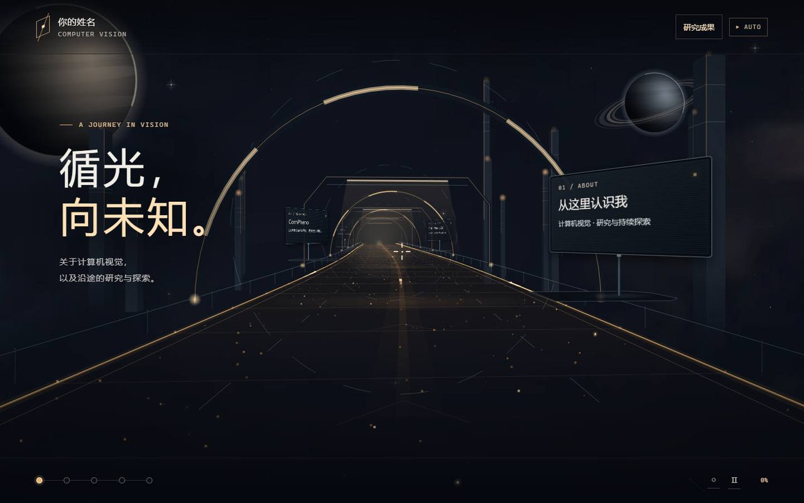

# 探索之路 · 科幻道路简历

一份沿着光与粒子之路前进的交互式个人简历：滚动前进，鼠标即视角，屏幕中心的十字准心对准路边显示器时，屏幕会在原位转向你并展开内容。背景是一张随视角和道路转动的 360° 全景星空。



## 在线查看

在线访问：<https://lipinzhe.github.io/starway/>

本地查看：直接双击 `index.html` 即可（不需要安装依赖、服务器或 API）。

单文件版：[`starway-standalone.html`](starway-standalone.html) 把整个网站（样式、脚本和星空贴图）打包进一个文件，不联网也能看。在 GitHub 上打开这个文件，点「Download raw file」下载，双击就能在浏览器里打开；也可以在线预览：<https://lipinzhe.github.io/starway/starway-standalone.html>。修改网站后，运行 `node tools/build-single.cjs` 重新生成。

## 操作

右上角的「研究成果」可以直接阅读三项研究，支持正常选择文字、点击链接和键盘操作。阅读时道路暂停，关闭后回到原来的位置。也可以直接分享 `#paper-cornpheno`、`#paper-cornpheno2` 或 `#paper-cornpetpp` 对应的地址。

研究内容核对于 2026-10-26：CornPheno 已发表；CornPheno 2.0 准备发表；CornPET++ 已获 IEEE ICDM 2026 的 MIDAS workshop 录用。两篇新工作的公开论文地址将在发布后补充。

| 操作 | 效果 |
| --- | --- |
| 滚轮 / 上下滑动 | 沿道路前进、后退 |
| 移动鼠标 | 转头与抬头 / 低头，屏幕中心为十字准心 |
| 准心对准路牌 | 路牌屏幕原位转向并展开；对准链接时单击打开 |
| 打开页面 | 开场结束后自动播放：沿路前进，依次转向每块路牌并展开，读完再继续 |
| 滚轮、按键、点击、触摸或大幅移动鼠标 | 随时接管，切换为手动浏览 |
| `AUTO` / 空格 | 开始或停止自动播放；看完后再点从头播放（网址加 `?autoplay=0` 关闭默认播放） |
| ← / → | 转头；`Tab` 依次对准各块路牌；`Home` / `End` 回到入口 / 前往终点 |

更完整的说明见 [使用说明.md](使用说明.md)。

## 技术要点

- 纯静态页面：HTML + CSS + 原生 JavaScript，没有任何第三方库或外部请求。
- 全景星空：按设备加载 1024 或 2048 像素宽的 WebP，全景投影使用精简 WebGL 着色器，不生成额外 mipmap；不支持 WebGL 时自动退回 2D。单文件版内嵌压缩贴图。
- 道路与光效：Canvas 2D 绘制，线条统一使用单设备像素细线或世界坐标中的填充条带，光晕使用预渲染贴图。
- 流畅度：交互目标约 60 帧/秒，静止且没有自动导览时停止绘制。道路画布限制在 150 万像素以内、星空约 65 万像素以内；正文仍以浏览器原生分辨率显示。2D 画布采用经过本机性能比较的软件后备存储，减少 GPU 路径缓存。
- 资源生命周期：阅读和后台状态释放场景纹理、行星缓存及画布后备尺寸，返回后按需恢复。直接打开论文链接时，不初始化 Canvas/WebGL 场景。
- 可访问性：语义化内容、研究阅读面板、键盘导航与减少动态效果。性能和可访问性需按具体设备及完整操作流程验证，首次加载的自动化分数不能代表全部交互。
- 路边显示器是真实 DOM 元素，通过 `matrix3d` 投影到道路世界坐标中，文字清晰、可被键盘访问。
- 特效：保留道路入场、快速前进时的超空间、流星和准心锁定；星云采用预先生成的纹理，标题直接显示，路牌标题用轻量淡入。系统开启“减少动态效果”时关闭动态效果。

## 目录

```
index.html              页面结构与路牌内容
assets/journey.js       输入、镜头、自动播放导览、帧节拍
assets/road-scene.js    道路、门架、光效、镜头投影
assets/sky-panorama.js  全景星空（WebGL）、星星、行星与流星
assets/effects.js       路牌标题的轻量淡入
assets/space-panorama-*.webp  按设备加载的背景纹理
assets/monitors.js      路边显示器的固定底座、转动与展开
assets/research.js      研究阅读面板、直接链接与浏览器返回
assets/research.css     阅读排版与五站导航
assets/*.css            样式
previews/               预览截图与开场动画（arrival.webp）
starway-standalone.html 单文件版（由 tools/build-single.cjs 生成）
tools/build-single.cjs  生成单文件版
tools/build-panorama.py 从保留的原始全景生成 WebP（需要 Pillow）
```

姓名、单位与联系方式仍为占位内容，补充后即可替换 `index.html` 中对应文字。
